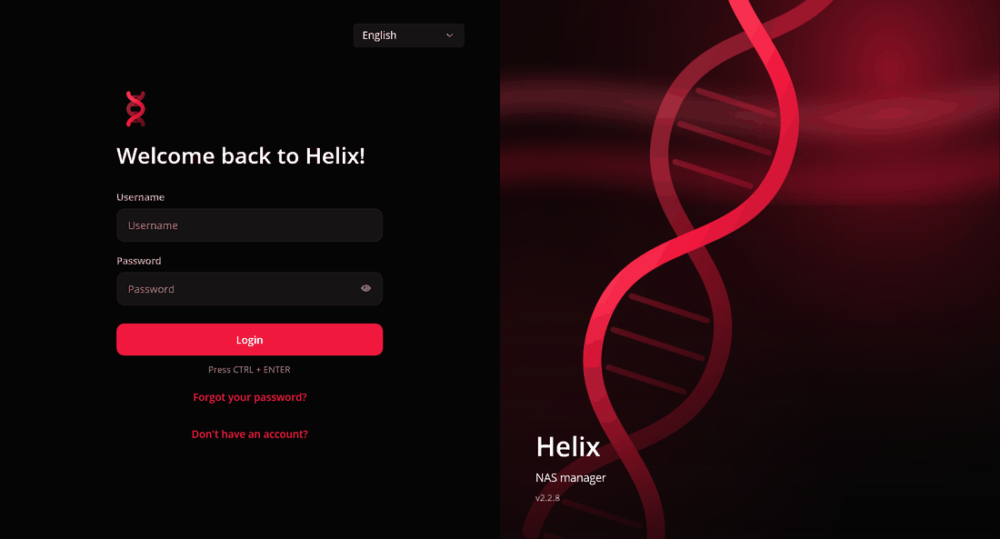
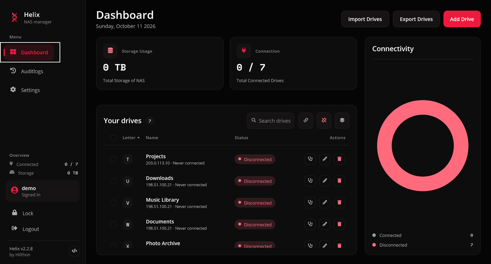

<div align="center">


# Helix

**Your NAS drives, connected and kept that way — on Windows and macOS.**

[](https://github.com/HilthonTT/Helix/actions/workflows/ci.yml)
[](https://github.com/HilthonTT/Helix/actions/workflows/codeql.yml)
[](https://github.com/HilthonTT/Helix/releases)
[](LICENSE)
[](https://hilthontt.github.io/Helix/)

[**Documentation**](https://hilthontt.github.io/Helix/) · [**Download**](https://github.com/HilthonTT/Helix/releases/latest) · [**Quick start**](https://hilthontt.github.io/Helix/docs/quick-start/)

<br />



</div>

## What it does

Helix maps network shares to drive letters (or folders on macOS), watches them, and brings
them back when they drop — after sleep, on a new network, or when the NAS wakes up. When a
drive will not connect, a four-step check tells you why.

- **Connect** one drive, a ticked selection, a saved group or everything, from the window,
  the tray, a global shortcut, a schedule or the command line.
- **Reconnect** unattended: a watchdog, Wake-on-LAN for a sleeping NAS, a home-network pin
  and an away address for VPN access.
- **Diagnose** the name, the server, the share and credentials, and the letter, step by step.
- **Keep it safe**: a SQLCipher-encrypted database, PBKDF2 passwords, a recovery key and
  AES-256-GCM vault exports.
- **Make it yours**: eight themes (Crimson by default) and six languages.

<div align="center">
  
</div>

## Install

Download the latest [release](https://github.com/HilthonTT/Helix/releases/latest):

- **Windows 10+** — `Helix-<tag>-win-x64.zip` (or `win-arm64`). Unzip anywhere and run
  `Helix.App.exe`; the build is self-contained.
- **macOS 15+** — `Helix-<tag>-macos.zip`, drag `Helix.app` to Applications. The bundle is
  unsigned, so right-click → **Open** the first time.

See [Installation](https://hilthontt.github.io/Helix/docs/installation/) for details.

## Build from source

Requires the [.NET 10 SDK](https://dotnet.microsoft.com/download) and the MAUI workload
(Visual Studio 2022 on Windows, Xcode on macOS).

```bash
git clone https://github.com/HilthonTT/Helix.git
cd Helix
dotnet build Helix.slnx
dotnet test Helix.slnx
```

`scripts/` wraps building, testing, publishing and migrations in PowerShell. The
[Development](https://hilthontt.github.io/Helix/docs/development/) and
[Architecture](https://hilthontt.github.io/Helix/docs/architecture/) pages cover the rest,
and [CONTRIBUTING.md](CONTRIBUTING.md) the pull request checklist.

## License

[MIT](LICENSE). Security issues: please follow [SECURITY.md](SECURITY.md) rather than opening
a public issue.
